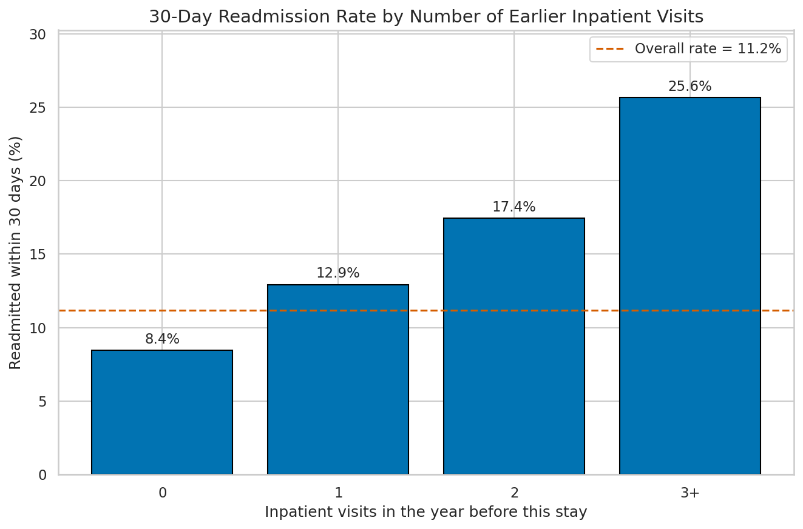
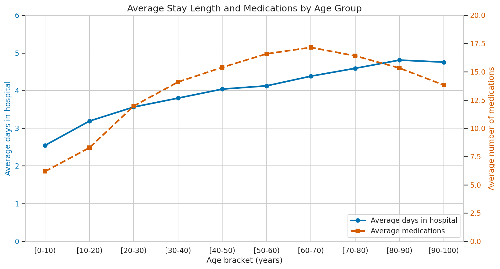
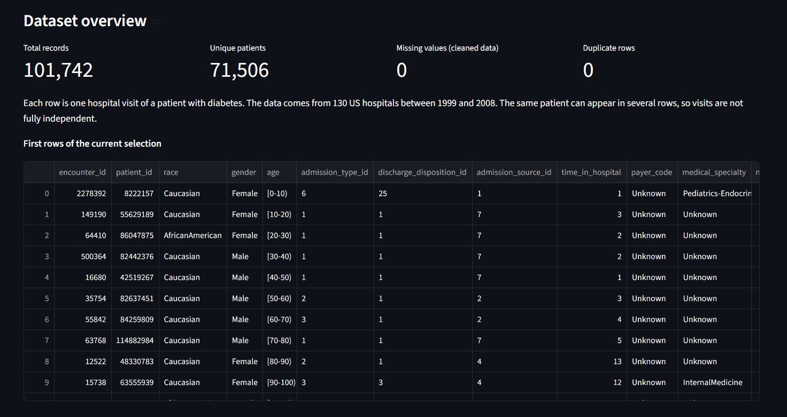

# Hospital Readmission Analysis: Diabetes 130-US Hospitals (1999-2008)

**Devixo Solutions - AI/ML Internship Program - Task 01: Python Programming, Data Analysis & Visualization**

## Project Objective

Take one real-world dataset through a complete data analysis workflow: load it, understand it, clean it, explore it, calculate statistics, visualize it and turn the results into evidence-based insights. The project also includes an interactive Streamlit dashboard (bonus task).

The analysis asks: what do hospital visits of patients with diabetes look like, and which factors are associated with being readmitted to hospital within 30 days?

## Dataset Description

Each row is one hospital visit (an *encounter*) of a patient with diabetes.

| | Raw data | Cleaned data |
|---|---|---|
| Rows (visits) | 101,766 | 101,742 |
| Columns | 50 | 49 |
| Unique patients | 71,518 | 71,506 |

The columns describe the patient (race, gender, age bracket), the visit (days in hospital, number of lab procedures, medications and diagnoses), the patient's visits in the previous year, diabetes medications, and the outcome `readmitted` (`NO`, `>30` days, `<30` days). A patient can appear in several rows.

## Dataset Source

- **Kaggle:** [Diabetes 130 US hospitals for years 1999-2008](https://www.kaggle.com/datasets/brandao/diabetes)
- **Original study:** Strack et al., *BioMed Research International*, 2014, Article ID 781670 (the file `description.pdf` supplied with the dataset). Data from 130 US hospitals collected between 1999 and 2008.

## Technologies Used

- Python 3
- Jupyter Notebook / Google Colab
- Streamlit (interactive dashboard)
- Git and GitHub

## Libraries Used

| Library | Purpose |
|---|---|
| Pandas | Loading, cleaning and analysing the data |
| NumPy | Numerical operations |
| Matplotlib | Charts |
| Seaborn | Statistical charts |
| Plotly | Interactive charts in the dashboard |
| Streamlit | Dashboard application |

## Project Workflow

```
Dataset selection -> Loading -> Understanding -> Cleaning -> EDA -> Statistics
-> Visualization -> Insights -> Conclusion -> Documentation -> GitHub
```

1. **Loading and understanding:** loaded with `keep_default_na=False` (the text "None" in two columns means "test not performed", not missing). An integrity check confirms 101,766 rows and 50 columns.
2. **Cleaning** (on a copy, with a log of every action): converted 192,849 hidden `?` placeholders to missing values, dropped `weight` (96.86% missing), labelled unknown categories, removed 24 rows (0.024%), converted data types, renamed 12 columns. Result: 0 missing values and 0 duplicates.
3. **EDA and statistics:** mean, median, mode, range, standard deviation, variance, correlation and group comparisons.
4. **Visualization:** 11 charts, each with a written interpretation.
5. **Insights and conclusion:** 14 insights, each tied to a number in the notebook.
6. **Dashboard:** Streamlit app reading the cleaned dataset.

## Major Findings

- Most hospital stays are short: 62.0% last 1 to 4 days (mean 4.40, median 4 days).
- 11.16% of visits ended in a readmission within 30 days; 53.9% were never readmitted.
- **Earlier inpatient visits show the clearest pattern:** the 30-day readmission rate rises from 8.44% (none) to 25.65% (three or more).
- Stay length and number of medications are moderately related (correlation 0.47); no pair of numeric variables exceeds 0.5, and none is strongly related to readmission.
- 81.6% of visits are for patients aged 50 to 89.
- The raw data hid a large amount of missing information behind `?` placeholders.

**Limitations:** the same patient can appear many times; the meaning of some code columns was not checked against the ID-mapping file; about half of the `medical_specialty` values are unknown. All findings are associations, not causes.

| | |
|---|---|
|  |  |

## Project Structure

```
Task_01_AI_ML/
├── app/
│   └── app.py                      Streamlit dashboard
├── dataset/
│   ├── diabetic_data.csv           Raw dataset
│   └── diabetic_data_cleaned.csv   Cleaned dataset (created by the notebook)
├── images/                         The 11 visualization images
├── notebook/
│   └── Task_01_Data_Analysis.ipynb Full analysis (Parts 1-6)
├── report/
│   ├── build_report.py             Builds the PDF report
│   └── Task_01_Report.pdf          PDF report
├── README.md
└── requirements.txt
```

## How to Run the Project

**1. Get the code and install the libraries**

```bash
git clone https://github.com/Al7bh/Devixo-Internship.git
cd Devixo-Internship/Task_01_AI_ML
pip install -r requirements.txt
```

**2. Run the notebook**

Open `notebook/Task_01_Data_Analysis.ipynb` in Jupyter or VS Code and choose **Run All**. It reads `dataset/diabetic_data.csv`, saves the charts in `images/` and saves `dataset/diabetic_data_cleaned.csv`.

*Google Colab:* upload `diabetic_data.csv` next to the notebook and run all cells; the cleaned file and the images are created in Colab's file panel (the last cell downloads the images as a zip).

**3. Start the dashboard** (needs `dataset/diabetic_data_cleaned.csv` from step 2)

```bash
streamlit run app/app.py
```

**4. Build the PDF report (optional)**

```bash
pip install reportlab pillow
python report/build_report.py
```

## Dashboard

The dashboard has KPI cards, sidebar filters (age, gender, race, medication change, days in hospital), interactive charts, summary statistics, a correlation heatmap and a key-insights tab.



## Author

**Muhammad Ali**: AI/ML Intern, Devixo Solutions
