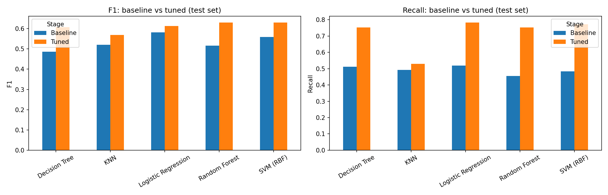

# Task 02 – Build and Compare Machine Learning Models

**Devixo Solutions – AI/ML Internship Program** | Student: Muhammad Ali

This project trains and compares several machine learning models on the **Telco Customer Churn** dataset and recommends the best one on evidence. It solves two problems on the same data:

| Problem | Target | Type | Models compared |
|---|---|---|---|
| **Task A (main)** | `Churn` – does the customer leave? | Classification | Logistic Regression, Decision Tree, Random Forest, KNN, SVM |
| **Task B** | `MonthlyCharges` – what is the monthly bill? | Regression | Linear Regression, Decision Tree, Random Forest, KNN, SVR |

The **bonus** (hyperparameter tuning with `GridSearchCV`) is done for all five classification models, with a before/after comparison.

## Dataset
- **Name:** Telco Customer Churn – file `WA_Fn-UseC_-Telco-Customer-Churn.csv`
- **Source:** Kaggle – <https://www.kaggle.com/datasets/blastchar/telco-customer-churn>
- **Size:** 7,043 rows × 21 columns (7,021 rows after removing 22 duplicate rows)
- **Note:** it is an IBM sample dataset about a **fictional** telecom company, so the findings describe this dataset and may not transfer to real customers.
- The CSV is not changed by the project. Download it from Kaggle and place it in `dataset/` (or upload it to Colab).

## Workflow
1. **Part 1 – Preprocessing:** the 11 blank `TotalCharges` values (hidden missing values that `isnull()` misses) are filled with 0 because all belong to customers with tenure 0; 22 duplicate rows removed; `customerID` dropped; target encoded; stratified 80/20 split; scaling and one-hot encoding fitted **inside a Pipeline on training data only** (no data leakage).
2. **EDA** on the training set (class balance, churn by contract, tenure by churn).
3. **Part 2 and 3 – Baseline models** with default settings, evaluated on the same test set (Accuracy, Precision, Recall, F1, confusion matrix; MAE, MSE, RMSE, R² for regression). A Dummy model is the reference floor.
4. **Bonus – Tuning:** `GridSearchCV`, 5-fold stratified cross-validation on the training set only, scored by F1; the test set is used once.
5. **Part 4 – Comparison tables** with training time, metrics, advantages and limitations.
6. **Part 5 – Conclusion** and limitations.

## Results (test set, from the notebook outputs)

### Task A – classification (churn is the positive class)
The Dummy model that always predicts "No churn" has accuracy **0.7352**.

| Model | Baseline F1 | **Tuned F1** | Tuned Recall | Tuned Precision | Tuned Accuracy | Fit time, tuned (s) |
|---|---|---|---|---|---|---|
| Logistic Regression | 0.5813 | 0.6126 | **0.7823** | 0.5035 | 0.7381 | 0.114 |
| Decision Tree | 0.4859 | 0.6074 | 0.7527 | 0.5091 | 0.7423 | 0.082 |
| Random Forest | 0.5168 | 0.6299 | 0.7527 | 0.5416 | 0.7658 | 1.632 |
| KNN | 0.5199 | 0.5685 | 0.5296 | 0.6137 | 0.7872 | 0.055 |
| SVM (RBF) | 0.5590 | **0.6301** | 0.7715 | 0.5325 | 0.7601 | 1.737 |

Fit times are the median of 5 single-core fits on a Colab CPU; differences of about 0.05 s are noise.



### Task B – regression (predict `MonthlyCharges`, default settings)

| Model | MAE | RMSE | R² |
|---|---|---|---|
| Dummy (mean) | 25.7137 | 29.6785 | -0.0000 |
| **Linear Regression** | **0.7997** | **1.0517** | **0.9987** |
| Decision Tree | 1.2426 | 1.6823 | 0.9968 |
| Random Forest | 1.0069 | 1.3555 | 0.9979 |
| KNN | 2.7637 | 4.2107 | 0.9799 |
| SVR (RBF) | 1.0294 | 1.3633 | 0.9979 |

## Key findings
- **Churn pattern:** the churn rate is 42.7% on month-to-month contracts, 11.2% on one-year and 2.9% on two-year contracts; the median tenure is 37 months for customers who stayed and 10 for those who left. These are associations, not causes.
- **Accuracy is misleading** on this imbalanced data: all baseline models find only 45% to 52% of the churners, and the unpruned Decision Tree has lower accuracy than the Dummy.
- **Tuning raised recall and F1 for every model** (class weights were chosen by all four models that support them), but it lowered precision for three of five. This is a trade-off between missed churners and false alarms, not a free improvement.
- **Recommended classification model: tuned Random Forest.** Its F1 (0.6299) is tied for the best with SVM (0.6301). The tie is broken by the highest cross-validated F1 (0.6397), the best precision among the models with recall of about 0.75 or more, and available feature importance. **Logistic Regression** is a defensible simpler alternative (F1 0.0173 lower, highest recall, more than ten times faster to fit).
- **Recommended regression model: Linear Regression** – best on all four metrics. The price is probably close to a sum of service charges (a hypothesis, not proven). All real models have R² above 0.97, so this task is easy.


## Limitations
- Fictional (sample) data; findings may not transfer to real customers.
- One train/test split with only 372 churners in the test set: F1 differences of about 0.01–0.02 are within noise.
- Fixed 0.5 decision threshold; no cost model for a missed churner versus a false alarm.
- Small grids; several best values sit at the grid edge, so a wider search might do slightly better.
- Colab timings are noisy; no tuning was done for the regression models; XGBoost (optional) was not used.

## Repository structure
```
Task_02_ML/
├── README.md
├── requirements.txt
├── .gitignore
├── dataset/                 # put WA_Fn-UseC_-Telco-Customer-Churn.csv here (download from Kaggle)
├── notebook/
│   └── Task2_Model_Comparison.ipynb   # full workflow with explanations and saved outputs
├── images/                  # figures created by the notebook
├── results/                 # result tables (CSV) created by the notebook
└── report/
    ├── Task_02_Report.pdf
    └── build_report_task2.py
```

## How to run
**Google Colab:** upload the notebook and the CSV, then choose *Runtime → Restart and run all*. A normal CPU runtime is enough (scikit-learn does not use the GPU). The Random Forest search takes a few minutes.

**Local:**
```bash
pip install -r requirements.txt
cd notebook
jupyter notebook Task2_Model_Comparison.ipynb      # the CSV is found in ../dataset/
```
Run all cells from top to bottom. The notebook creates `images/` and `results/` next to `notebook/`. Results are reproducible (random seed 42); only the timings change between machines.

**Rebuild the PDF report** (after re-running the notebook and saving it with its outputs):
```bash
python report/build_report_task2.py
```
The script reads the numbers and charts from the notebook outputs and the CSV, and warns if a written statement no longer matches the results.

## Technologies
Python 3, Pandas, NumPy, Scikit-learn, Matplotlib, Seaborn, Jupyter / Google Colab, ReportLab (report).
